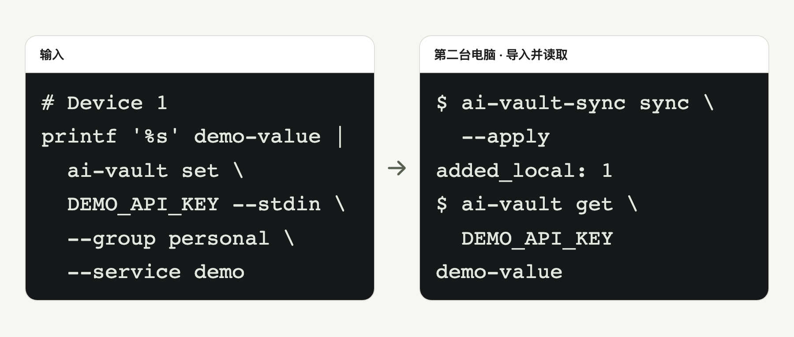

# ai-vault

**给 AI 工具和脚本集中管理 API Key，换台电脑也能接着用。**

Local API keys, optional encrypted sync.

[快速开始](#快速开始) · [检查和清理](#检查和清理失效-key) · [多设备同步](#多设备同步) · [数据与权限](#数据与权限) · [版本下载](https://github.com/bmdy6/ai-vault/releases/latest)

<picture>
  <source media="(prefers-color-scheme: dark)" srcset="docs/readme/hero-dark.zh-CN.png">
  
</picture>

本地 Supabase 实跑。第一台存入示例 Key，第二台配对并从加密快照导入后读到同一个值。 [图源](docs/readme/SOURCES.md) · EN [浅色](docs/readme/hero-light.png) / [深色](docs/readme/hero-dark.png)

## 快速开始

支持 macOS、Linux，需 Python 3.10+ 和 [uv](https://docs.astral.sh/uv/getting-started/installation/)。本机使用无需配置 Supabase。复制整个代码块安装。

```sh
repo=https://github.com/bmdy6/ai-vault
uv tool install "git+$repo@v0.1.0"
uv tool list
```

### 用临时目录试一次

```sh
demo_dir=$(mktemp -d)
ai-vault --vault-home "$demo_dir" init
printf '%s' 'demo-value' | ai-vault --vault-home "$demo_dir" set DEMO_API_KEY \
  --group personal --service demo --stdin
ai-vault --vault-home "$demo_dir" list --group personal
```

列表会显示 `personal / demo` 下的 `DEMO_API_KEY`，值显示为 `***`。这个例子使用临时目录。日常使用可以省略 `--vault-home`，默认目录是 `~/.config/ai-vault`。如提示命令找不到，运行 `uv tool update-shell` 后重开终端。

<details>
<summary>用 pip 从源码安装</summary>

```sh
git clone https://github.com/bmdy6/ai-vault.git
cd ai-vault
python3 -m venv .venv
. .venv/bin/activate
python -m pip install .
```

</details>

| 场景 | 用法 |
| --- | --- |
| 把不同工具的 Key 放在一处 | 用分组和服务组织。交互式 `set` 隐藏输入，脚本可通过管道传入 `set --stdin`。 |
| 给本机脚本取一个 Key | `get` 会将值写到标准输出，适合交给受信任的进程。 |
| 更新或删除旧值 | `update` 和 `delete` 在交互终端输入名称确认。 |
| 换电脑 | 选分组、预览差异、上传加密快照，再用配对包接入。 |

## 检查和清理失效 key

从当前源码安装这一功能：`uv tool install --force .`。Python 3.10+，检测还需要 `curl`。`check` 不调用生成接口，不消耗生成额度；使用模型列表、余额、身份等只读请求。检测会自动备份本地 vault，再写回条目的 `status` 和 `last_checked`，`list` 会显示这些字段。

```sh
ai-vault check
ai-vault check --group personal --service deepseek
ai-vault prune                         # 默认只预览，不改 vault
ai-vault prune --confirm               # 真实终端列清单后输入 CONFIRM
ai-vault restore personal/deepseek/OLD_API_KEY  # 真实终端确认恢复
```

| 检测结果 | 含义 | 会进入清理清单吗 |
| --- | --- | --- |
| `ok` | 探测接口认证成功；不保证生成权限或后续可用额度 | 否 |
| `invalid` | 接口明确拒绝认证或报告 key 无效 | 是 |
| `expired` | 接口明确报告 key/token 过期 | 是 |
| `no_balance` | key 有效，余额不足 | 否 |
| `unknown` | 没有检测方法、网络错误、限流、WAF 或无法识别的响应 | 否 |

输出表包含分组/服务/名称、前 4 后 4 脱敏值（短值仅显示 `***`）、结果、固定原因和 UTC 检测时间；响应原文和认证头不会进入输出。同一个服务两次请求之间至少间隔 1 秒，不跟随重定向。配置了其他供应商的 base URL 时，内置官方探测会跳过，以免把中转 key 判错。

Agent 必须先把清理清单交给用户确认；确认之后才能传 `--yes` **和完整条目路径**，不能只传 `--yes`：

```sh
ai-vault prune --yes personal/deepseek/OLD_API_KEY
ai-vault restore --yes personal/deepseek/OLD_API_KEY
```

所有选择会先一起校验；选到有效 key、未知路径、重复项或恢复会覆盖现有值时，整批拒绝。`prune --confirm` 也可跟条目列表只删指定项。删除前在 vault 目录的 `backups/` 保存权限 0600 的备份，之后在同一次原子写入中保存回收站和删除标记。回收站默认保留 30 天，到期后禁止恢复，在下次清理写入时移除过期内容；删除标记长期保留。备份不会自动到期，需要用户自行管理。恢复后状态为 `unknown`，需重新检测。原有 `delete` 也会备份并写入回收站/删除标记。

### 探测配置与安全边界

配置位于 [`ai_vault_data/probes.json`](ai_vault_data/probes.json)，可用 `check --probes /path/to/probes.json` 选择**受信任**的自定义配置。地址、认证头、服务名模式、条目名模式、可选前缀和响应规则都在文件里；占位符 `{key}` 只在请求时替换。URL 中的 key 会编码。配置能决定凭据发往哪里，不要使用未经核对的来源或写入/生成接口。`POST` 仅为 Linear 的只读 GraphQL 查询使用。

每条 `rules` 按顺序匹配：`http` 状态码列表、可选 `contains` 字符串、可选 JSON `field`（点分路径）及 `equals` 值。无匹配返回 `unknown`；429、5xx、HTML 和 Cloudflare 响应优先返回 `unknown`。`services` / `keys` 支持 glob，服务匹配忽略大小写，名称模式使用大写。同步启动凭据始终不检测、不清理。

| 内置服务 | 只读接口 / 限制 | 参考 |
| --- | --- | --- |
| OpenAI | `GET /v1/models` | [官方文档](https://platform.openai.com/docs/api-reference/models/list) |
| DeepSeek（含 `*-deepseek` 服务） | `GET /user/balance`；`is_available=false` 为 `no_balance` | [官方文档](https://api-docs.deepseek.com/api/get-user-balance/) |
| Anthropic | `GET /v1/models` | [官方文档](https://platform.claude.com/docs/en/api/models/list) |
| CommandCode | `GET /alpha/billing/credits`；正常 User-Agent；余额响应未识别仍记 `unknown` | [提供商文档](https://commandcode.ai/docs/provider)；alpha 余额接口未在该页承诺，实际失效 key 返回 401 |
| Pixabay | `GET /api/?key=…`（图片搜索） | [官方文档](https://pixabay.com/api/docs/) |
| GitHub | `GET /user`；受限安装 token 可能为 `unknown` | [官方文档](https://docs.github.com/en/rest/users/users#get-the-authenticated-user) |
| Telegram Bot | `GET /bot…/getMe` | [官方文档](https://core.telegram.org/bots/api#getme) |
| Linear | `POST /graphql`，仅查询 `viewer { id }` | [官方文档](https://linear.app/developers/graphql) |
| Supabase | `GET /v1/projects`，仅 `sbp_` 管理 API token；项目 anon/service-role key 记 `unknown` | [官方文档](https://supabase.com/docs/reference/api/introduction) |

### 删除如何同步

`ai-vault-sync sync` 预览新增及删除数量；`sync --apply` 才应用。删除标记只含路径与 UTC 时间，经现有 AES-GCM 快照传输，回收站里的明文不会上传。A 删除后，B 同步会备份并移除对应项；B 的旧副本再次同步也不能复活它。只有比删除更新的明确恢复标记才能恢复。检测状态和时间的差异不会产生凭据冲突。

涉及删除/恢复的快照采用格式 3；仍能读取旧格式 1/2。**所有设备都需升级**：旧客户端会拒绝格式 3，而不是忽略删除。尚未升级的设备无法完成同步。已授权分组、blocked_keys 和启动凭据排除规则仍适用，未授权分组不参与删除。

### AI 技能入口

[`skills/ai-vault`](skills/ai-vault) 是兼容技能：将其复制到技能目录前先备份旧目录，并先安装仓库命令。`scripts/vault.py` 只调用已安装的 `ai-vault`，不包含另一份存储实现，也不依赖临时 worktree。源码改动后需重新安装命令。`get` 仍会输出明文，仅交给受信任的消费进程。

## 多设备同步

需要 `curl` 和自己的 Supabase 项目。先按[部署说明](docs/supabase.md)配置数据库和 Edge Function，再初始化首台设备。

```sh
ai-vault-sync init-sync \
  --endpoint https://YOUR_PROJECT_REF.supabase.co/functions/v1/vault-sync \
  --group personal
```

在 Supabase SQL Editor 执行终端显示的登记语句。语句里只有设备 ID 和令牌摘要。

| 位置 | 命令 |
| --- | --- |
| 第一台电脑 | `ai-vault-sync sync` 预览，`ai-vault-sync sync --apply` 同步并回读，`ai-vault-sync pair second-device.pairing` 创建配对包。 |
| 第二台电脑 | `ai-vault-sync join second-device.pairing` 接入。再运行 `sync` 预览，`sync --apply` 导入。 |

配对文件和口令分开传。两边同名记录不一致时，同步会停下。确认要保留哪一份后，在终端用 `ai-vault-sync resolve DEMO_API_KEY --use local` 或 `--use cloud` 处理。云端保留快照历史，本机删除不传播到云端，后续同步可能重新导入已删条目。

## 数据与权限

- **本地库是明文 JSON。** 应用创建的文件权限是 `0600`。保护好本机账户、备份和 `get` 的输出。
- **云端保存加密快照。** 选中的分组在客户端用 AES-256-GCM 加密。设备 ID、快照版本、条数和时间等元数据仍可见。
- **一个实例供一位用户的可信设备共用。** 配对设备共享主密钥，已授权设备可以读取同一个云端快照和登记新设备。
- 配对包包含主密钥和设备令牌，用完后清理传输副本，并保管独立的主密钥恢复副本。设备撤销会停止后续访问。对已经泄露的业务凭据或主密钥，需要另行更换。

## 开发与验证

```sh
uv run --locked python -m unittest discover -s tests -v
```

14 个单元测试和本地 Supabase 的两套 vault 同步流程已验证。托管项目部署后，请[验收自己的实例](docs/supabase.md#部署到自己的项目)。

[MIT](LICENSE)

探测接口参考：[OpenAI models](https://platform.openai.com/docs/api-reference/models/list)、[DeepSeek 余额](https://api-docs.deepseek.com/api/get-user-balance/)、[Anthropic models](https://platform.claude.com/docs/en/api/models/list)、[Pixabay](https://pixabay.com/api/docs/)、[GitHub 当前用户](https://docs.github.com/en/rest/users/users#get-the-authenticated-user)、[Telegram getMe](https://core.telegram.org/bots/api#getme)、[Linear GraphQL](https://linear.app/developers/graphql)、[Supabase Management API](https://supabase.com/docs/reference/api/introduction)。CommandCode 的 `/alpha/billing/credits` 是未公开稳定契约的余额接口；已在真实检测中验证拒绝/过期响应，规则失配时保持 `unknown`。其 [Provider 文档](https://commandcode.ai/docs/provider) 说明 401 认证失败与 403 权限限制的区别。
