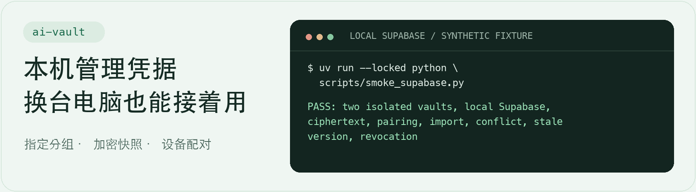

# ai-vault

**给 AI 工具和脚本集中管理 API Key，换台电脑也能接着用。**

Group credentials locally and optionally sync encrypted snapshots to your own Supabase project.

[快速开始](#快速开始) · [多设备同步](#多设备同步) · [数据与权限](#数据与权限) · [版本下载](https://github.com/bmdy6/ai-vault/releases/latest)

<picture>
  <source media="(prefers-color-scheme: dark)" srcset="docs/readme/sync-dark.png">
  
</picture>

图中终端是使用虚构凭据的真实本地 Supabase 验证节选。 [复现步骤](docs/supabase.md#本地验收) · [图源](docs/readme/SOURCES.md)

## 快速开始

支持 macOS、Linux，需 Python 3.10+ 和 [uv](https://docs.astral.sh/uv/getting-started/installation/)。本机用法无需配置 Supabase。

```sh
uv tool install 'git+https://github.com/bmdy6/ai-vault@v0.1.0'

demo_dir=$(mktemp -d)
ai-vault --vault-home "$demo_dir" init
printf '%s' 'demo-value' | ai-vault --vault-home "$demo_dir" set DEMO_API_KEY \
  --group personal --service demo --stdin
ai-vault --vault-home "$demo_dir" list --group personal
```

列表会显示 `personal / demo` 下的 `DEMO_API_KEY`，值显示为 `***`。这个例子使用临时目录。日常使用可以省略 `--vault-home`，默认目录是 `~/.config/ai-vault`。如提示命令找不到，运行 `uv tool update-shell` 后重开终端。

<details>
<summary>用 pip 从源码安装</summary>

```sh
git clone https://github.com/bmdy6/ai-vault.git
cd ai-vault
python3 -m venv .venv
. .venv/bin/activate
python -m pip install .
```

</details>

| 场景 | 用法 |
| --- | --- |
| 把不同工具的 Key 放在一处 | 用分组和服务组织。交互式 `set` 隐藏输入，脚本可通过管道传入 `set --stdin`。 |
| 给本机脚本取一个 Key | `get` 会将值写到标准输出，适合交给受信任的进程。 |
| 更新或删除旧值 | `update` 和 `delete` 在交互终端输入名称确认。 |
| 换电脑 | 选分组、预览差异、上传加密快照，再用配对包接入。 |

## 多设备同步

需要 `curl` 和自己的 Supabase 项目。先按[部署说明](docs/supabase.md)配置数据库和 Edge Function，再初始化首台设备。

```sh
ai-vault-sync init-sync \
  --endpoint https://YOUR_PROJECT_REF.supabase.co/functions/v1/vault-sync \
  --group personal
```

在 Supabase SQL Editor 执行终端显示的登记语句。语句里只有设备 ID 和令牌摘要。

| 位置 | 命令 |
| --- | --- |
| 第一台电脑 | `ai-vault-sync sync` 预览，`ai-vault-sync sync --apply` 同步并回读，`ai-vault-sync pair second-device.pairing` 创建配对包。 |
| 第二台电脑 | `ai-vault-sync join second-device.pairing` 接入。再运行 `sync` 预览，`sync --apply` 导入。 |

配对文件和口令分开传。两边同名记录不一致时，同步会停下。确认要保留哪一份后，在终端用 `ai-vault-sync resolve DEMO_API_KEY --use local` 或 `--use cloud` 处理。云端保留快照历史，本机删除不传播到云端，后续同步可能重新导入已删条目。

## 数据与权限

- **本地库是明文 JSON。** 应用创建的文件权限是 `0600`。保护好本机账户、备份和 `get` 的输出。
- **云端保存加密快照。** 选中的分组在客户端用 AES-256-GCM 加密。设备 ID、快照版本、条数和时间等元数据仍可见。
- **一个实例供一位用户的可信设备共用。** 配对设备共享主密钥，已授权设备可以读取同一个云端快照和登记新设备。
- 配对包包含主密钥和设备令牌，用完后清理传输副本，并保管独立的主密钥恢复副本。设备撤销会停止后续访问。对已经泄露的业务凭据或主密钥，需要另行更换。

## 开发与验证

```sh
uv run --locked python -m unittest discover -s tests -v
```

14 个单元测试和本地 Supabase 的两套 vault 同步流程已验证。托管项目部署后，请[验收自己的实例](docs/supabase.md#部署到自己的项目)。

[MIT](LICENSE)
